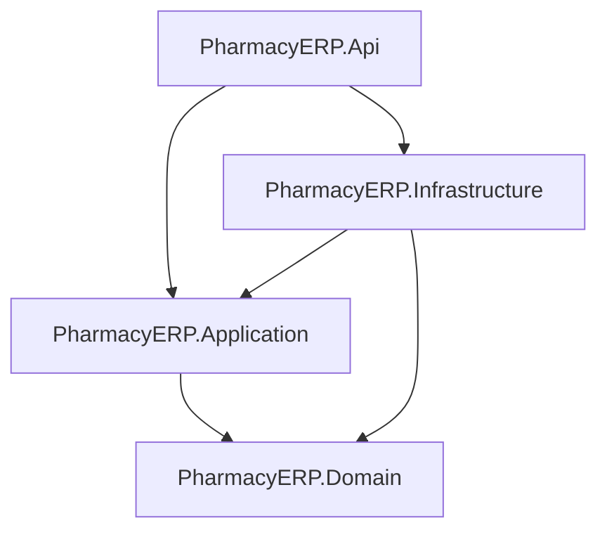

# PharmacyERP Architecture

A modular, clean-architecture ERP system for pharmacy management built on .NET 10.

## Solution Layout

```text
PharmacyERP/
├── PharmacyERP.sln
├── PharmacyERP.slnx
├── src/
│   ├── PharmacyERP.Api/                 # ASP.NET Core Web API host
│   │   ├── Controllers/                 # REST API controllers
│   │   ├── Middleware/                  # Exception handling, logging, tenant middleware
│   │   ├── Auth/                        # Authentication & authorization handlers
│   │   └── Versioning/                  # API versioning setup
│   │
│   ├── PharmacyERP.Application/         # Business logic & use cases
│   │   ├── Common/                      # Cross-cutting application concerns
│   │   │   ├── Interfaces/              # Abstractions (ICurrentUser, IDateTime, etc.)
│   │   │   ├── DTOs/                    # Shared data transfer objects
│   │   │   ├── Validation/              # FluentValidation behaviors / validators
│   │   │   ├── Mappings/                # Mapping configurations (Mapster / AutoMapper)
│   │   │   └── Exceptions/              # Application exceptions (NotFound, Validation, etc.)
│   │   └── Features/                    # Vertical slice use cases (Commands, Queries, DTOs)
│   │       ├── Identity/                # Auth, users, roles, permissions
│   │       ├── Catalog/                 # Medicines, categories, manufacturers, barcodes
│   │       ├── Inventory/               # Batches, expiry tracking, stock movements, adjustments
│   │       ├── Sales/                   # POS, invoices, returns, shifts, discounts
│   │       ├── Purchasing/              # Purchase orders, supplier bills, receiving
│   │       └── Integration/             # External sync, third-party integrations
│   │
│   ├── PharmacyERP.Domain/              # Pure domain layer (no external dependencies)
│   │   ├── Entities/                    # Core aggregate roots and entities
│   │   │   ├── Identity/
│   │   │   ├── Catalog/
│   │   │   ├── Inventory/
│   │   │   ├── Sales/
│   │   │   └── Purchasing/
│   │   ├── ValueObjects/                # Money, Address, Barcode, BatchNumber, etc.
│   │   ├── Enums/                       # Domain enumerations (OrderStatus, PaymentMethod, etc.)
│   │   ├── Invariants/                  # Domain business rules & invariants
│   │   └── Exceptions/                  # Domain-specific exceptions
│   │
│   ├── PharmacyERP.Infrastructure/      # External concerns & persistence
│   │   ├── Persistence/
│   │   │   ├── Configurations/          # EF Core entity configs (IEntityTypeConfiguration)
│   │   │   ├── Repositories/            # Generic CRUD & workflow-specific repositories
│   │   │   └── Migrations/              # EF Core database migrations
│   │   ├── BackgroundServices/          # Local/cloud sync worker and outbox publisher
│   │   └── ObjectStorage/               # S3-compatible image storage (MinIO/AWS S3)
│   │
│   └── Features/                        # Cross-solution modular features folder
│       ├── Identity/
│       ├── Catalog/
│       ├── Inventory/
│       ├── Sales/
│       ├── Purchasing/
│       └── Integration/
│
├── tests/
│   ├── PharmacyERP.UnitTests/           # Unit tests for Domain & Application
│   │   ├── Domain/
│   │   ├── Application/
│   │   └── Infrastructure/
│   └── PharmacyERP.IntegrationTests/    # Integration tests
│       ├── Api/
│       ├── Persistence/
│       └── BackgroundServices/
│
└── contracts/                           # API definitions & schemas
    ├── OpenAPI/                         # OpenAPI / Swagger specification files
    ├── JSONSchema/                      # JSON schemas for payloads & integration messages
    └── Fixtures/                        # Test fixtures & sample seed payloads
```

## Dependency Flow


